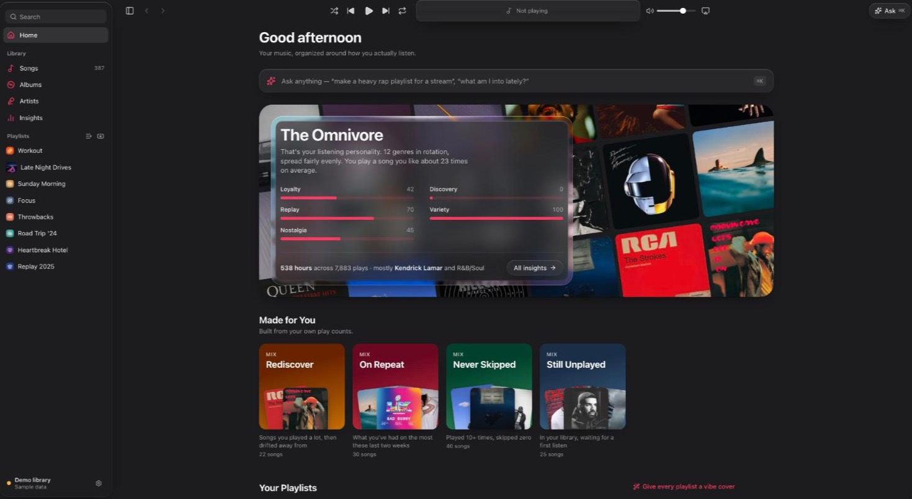
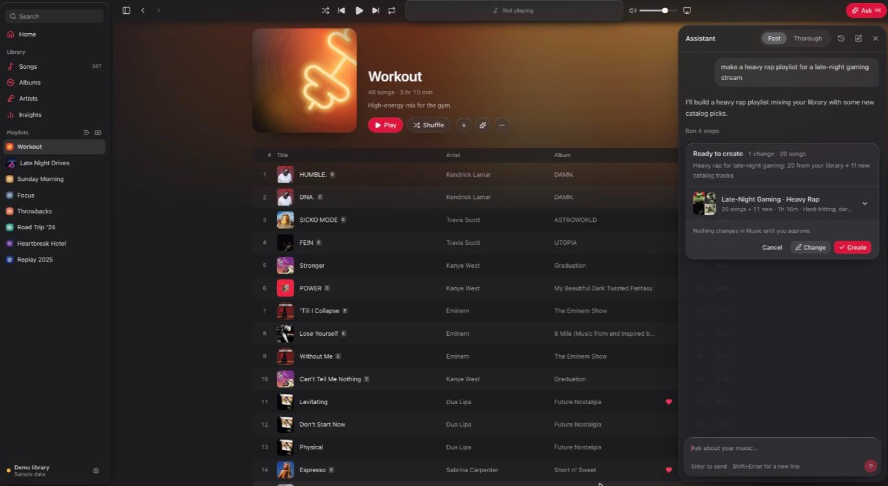
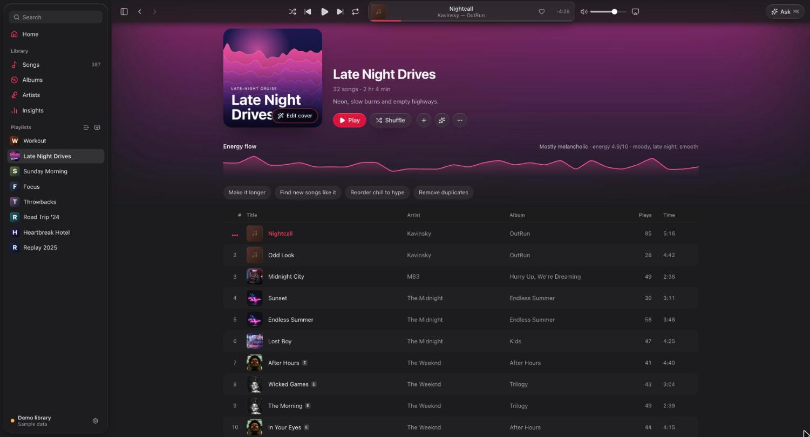
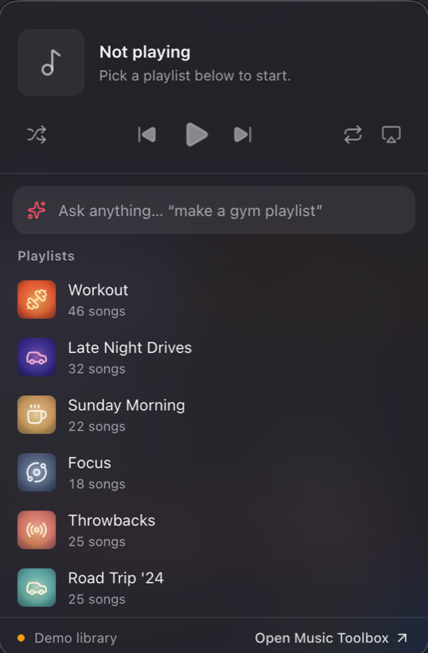
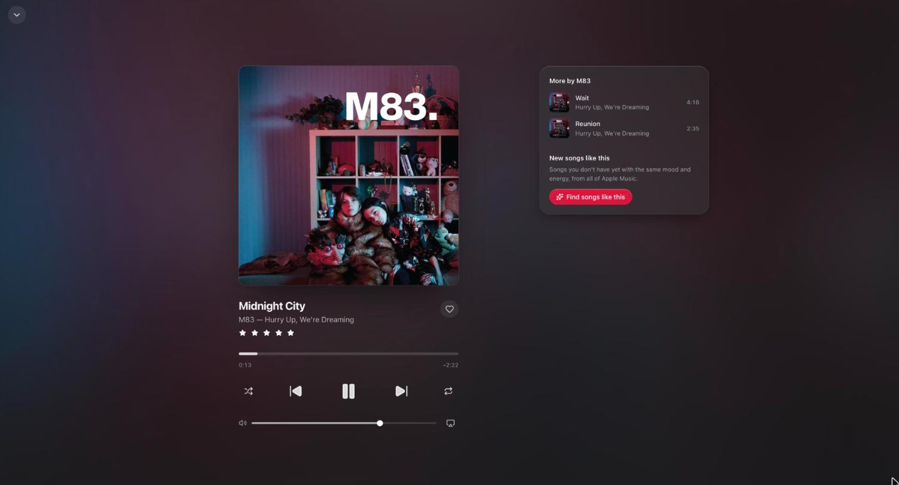
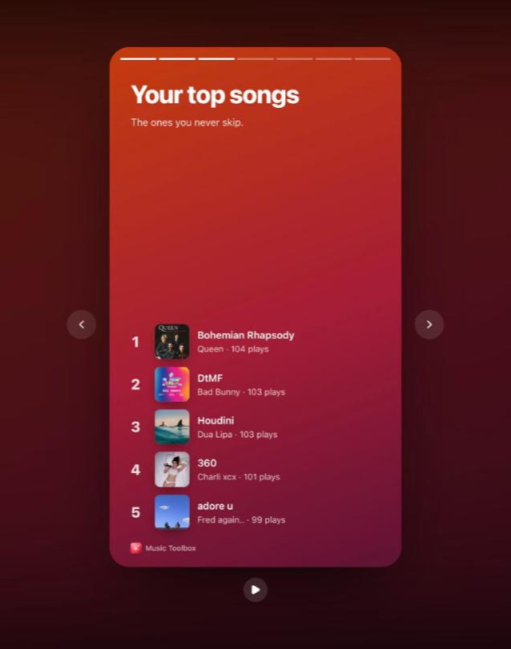

# Music Toolbox

**Apple Music, upgraded.** A Mac app that works alongside the Music app. Ask for a playlist in plain words and get
songs from your library *and* all of Apple Music, give every playlist a cover that matches its vibe, see how you
actually listen, and control playback from the menu bar.

  

<table>
  <tr>
    <td width="40%"></td>
    <td width="40%"></td>
    <td width="20%"></td>
  </tr>
  <tr>
    <td>Ask for a playlist: your songs plus new ones</td>
    <td>Every playlist's energy, song by song</td>
    <td>The menu bar, from any app</td>
  </tr>
  <tr>
    <td width="40%"></td>
    <td width="40%" colspan="2"></td>
  </tr>
  <tr>
    <td>Now Playing, with songs like this from Apple Music</td>
    <td colspan="2">Your listening story</td>
  </tr>
</table>

## Download

**[Get the latest version →](https://github.com/kxnerx/apple-music-toolbox-releases/releases)**

**Newest test build: [0.1.1-test.3](https://github.com/kxnerx/apple-music-toolbox-releases/releases/tag/v0.1.1-test.3)**:
a smarter assistant that picks songs that fit what you ask for and keeps every rule you give it (artists or genres
to leave out, clean only, an era, an exact length or song count), accurate Insights, Liquid Glass blur back on
menus and dialogs, and many bug fixes. [See everything that changed →](https://github.com/kxnerx/apple-music-toolbox-releases/releases/tag/v0.1.1-test.3)

You need an **Apple Silicon Mac** (M1 or newer) and the Music app. An Apple Music subscription lets the assistant
suggest new songs, and your own [OpenRouter key](https://openrouter.ai/settings/keys) (a few cents of credit goes a
long way) turns on the assistant, recommendations and AI covers.

> **Test builds** (versions ending in `-test.N`) are early previews. They don't update themselves: when a full
> release comes out, install it once by hand, and from then on Music Toolbox keeps itself up to date.

## Install

1. Download `MusicToolbox-<version>-arm64.dmg` from the latest release.
2. Open it and drag **Music Toolbox** into **Applications**.
3. Open it from Applications. It isn't notarized by Apple yet, so the first time:
   - **macOS 15 and later:** try to open it, click **Done**, then go to **System Settings → Privacy & Security** and
     click **Open Anyway**.
   - **Earlier versions:** right-click the app → **Open** → **Open**.
4. When macOS asks whether Music Toolbox may control **Music**, choose **Allow**. That's how it reads your library and
   builds playlists.
5. Press **⌘,** for Settings and paste your OpenRouter key.

## What you can do

| | |
| --- | --- |
| **Ask** (⌘K) | "Make a heavy rap playlist for a gaming stream", "chill rap but not sad, about 45 minutes", "add 15 songs to Workout", "take the rap out of my Workout playlist into its own playlist", "what am I into lately?" Every song is checked against what you asked, and rules like "no Drake", "clean" or "90s" are kept. Anything that changes your library shows up as a plan you approve first. |
| **New music** | Playlists mix your library with new songs from Apple Music. New songs wait on the playlist: click **Add all in Music** and press **+** on each; they move into the playlist by themselves. |
| **Your library** | Songs, albums and artists like the Music app, with love, ratings, *Get Info*, sorting, multi-select and drag-and-drop onto playlists. |
| **Playlists** | Rename, add, remove (with Undo), export to CSV, text, M3U or JSON, and import from a file. |
| **Vibe covers** | Every playlist gets a cover that matches its mood, in four instant styles (Type, Neon, Wave, Blend) or AI art in about 3 seconds. Drag a cover onto the playlist in Music to use it there. |
| **Now Playing** | Click the artwork (or ⌘⇧F) for a full-window player: every control, AirPlay, more by the artist, and **Find songs like this** from all of Apple Music. |
| **Energy flow** | Every playlist shows its energy song by song and its moods; hover to find a song, click to play from it. One-tap ideas sit right above the songs. |
| **Insights** | Your listening personality, top artists and songs, what you're into lately, forgotten favorites, songs you skip, and **Your listening story**: full-screen cards you can save as images. |
| **Menu bar** | Now playing, AirPlay, Ask and your playlists from any app. **⌃⌥Space** opens it with Ask ready. |
| **Keyboard** | Space plays/pauses, ⌘→ / ⌘← skip, ⌘↑ / ⌘↓ volume, ⌘1–5 jump between sections, ⌘F search, ⌘⇧F Now Playing. |

## Questions

**Why do new songs need a + press in Music?**
Apple only lets apps add Apple Music catalog songs to your library through a paid developer program. Until then,
Music Toolbox queues them on the playlist and opens each one in Music for you; as soon as you press +, it drops
into the playlist.

**Is my data sent anywhere?**
Your library stays on your Mac. When you ask the assistant something, the AI model sees song titles, artists and
listening stats for that request, through your own OpenRouter key. There's no account, analytics or tracking. Your
key is stored only on your Mac and never shown again.

**How do updates work?**
Full releases update themselves: Music Toolbox checks GitHub at launch and every few hours, downloads quietly, and
asks before restarting. It has to be in your Applications folder to update. You can turn checks off in Settings.

**Does it work on Intel Macs or Windows?**
Not yet: Apple Silicon Macs only.

**How do I uninstall it?**
Quit it from the menu bar icon, drag Music Toolbox from Applications to the Trash, and delete
`~/Library/Application Support/Apple Music Toolbox` to remove its settings, covers and saved conversations. Your
Music library and playlists aren't touched.

## Feedback

Found a bug or have an idea? **[Open an issue](https://github.com/kxnerx/apple-music-toolbox-releases/issues/new/choose)**,
or use **Settings → Report a problem** in the app. Please don't include your OpenRouter key or other secrets.
Security problems: see [SECURITY.md](SECURITY.md).

---

This repository holds the built app and its release notes. Each full release also carries the `releases.json` file
that installed copies read to find updates.
